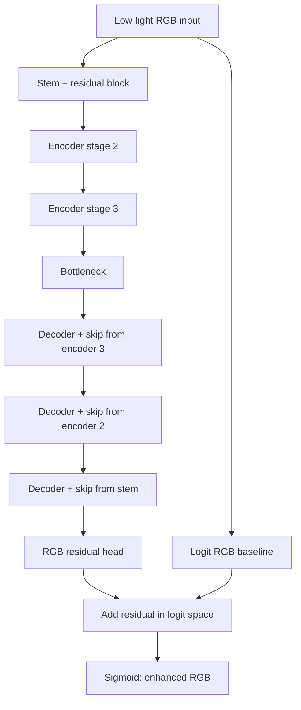

# Paired RGB U-Net Architecture

## Overview

`PairedRGBRestorationNet` is a compact, supervised low-light restoration network. It takes a low-light RGB image (I_{low}) with shape ((B,3,H,W)) and predicts an enhanced RGB image with the same shape.

## Main components

- **Stem:** 3x3 RGB convolution, GroupNorm, SiLU, and a residual block.
- **Encoder:** three spatial reductions with convolutional downsampling and depthwise-separable residual refinement.
- **Decoder:** bilinear upsampling, skip concatenation, feature fusion, and residual refinement.
- **RGB residual head:** predicts three correction channels. Its weights and bias initialize to zero, making the initial output close to the input.
- **Resolution handling:** inputs are padded to a multiple of eight and cropped back to their original spatial dimensions.

## Training objective

The paired loss combines RGB L1 fidelity with luminance, chroma, gradient, and local-contrast terms. The reference image is used only as a supervised target for training and validation on the held-out subset of `our485`.

## Default footprint

With `base_channels=24`, the model has 409,347 trainable parameters. Parameter count alone does not establish output quality; use the evaluation script and inspect visual comparisons.
