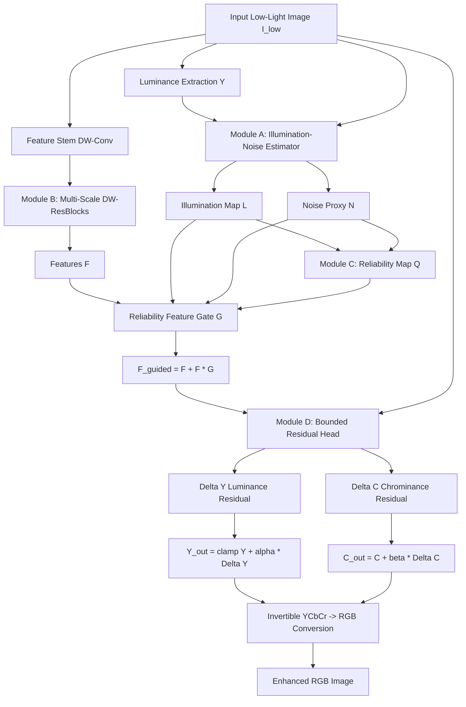

# Architecture Specification: LumaGuard-Net

## High-Level Overview
**LumaGuard-Net** is a lightweight, depthwise-separable convolutional neural network designed for self-supervised low-light image enhancement. Inspired by the fundamental challenge of noise-illumination coupling addressed in CVPR 2022 research, LumaGuard-Net replaces heavy Transformer self-attention with compact spatial estimation and reliability-guided modulation modules.

The model strictly targets a lightweight footprint (<1 million parameters, with the default variant having ~27,049 parameters) while explicitly isolating illumination and noise uncertainty proxies.

## Module Descriptions

### Module A: Illumination–Noise Estimator (INE)
- **Input**: Concatenation of $I_{\text{low}} \in \mathbb{R}^{B \times 3 \times H \times W}$ and luminance $Y = 0.299R + 0.587G + 0.114B$.
- **Backbone**: Encoder-decoder with depthwise-separable convolutions, average pooling downsampling ($2\times$ and $4\times$ reduction), and bilinear upsampling with skip connections.
- **Predictions**:
  - $L \in (0, 1]$: Spatial illumination map.
  - $N \in [0, 1]$: Learned noise proxy / uncertainty map.
- **Scientific Caveat**: $N$ represents a learned uncertainty proxy and is not calibrated to physical sensor noise unless paired with raw sensor noise calibrations.

### Module B: Compact Multi-Scale Feature Extractor
- Lightweight depthwise-separable residual blocks with cyclic dilation rates ($d \in \{1, 2, 1, 2\}$) to enlarge the receptive field without adding parameter overhead or checkerboard artifacts.
- Parametric budget: $\approx 15,000$ parameters across 4 residual blocks.

### Module C: Reliability-Guided Feature Modulation
- **Reliability Map ($Q$)**:
  $$Q = \sigma(a \cdot \log(L + \epsilon) - b \cdot N + c)$$
  where $a, b, c$ are learnable parameters initialized to $1.0, 1.0, 0.0$.
- **Gate ($G$)**:
  $$G = \sigma(\text{Conv}_{1\times 1}(\text{concat}(F, L, N, Q)))$$
- **Modulated Features**:
  $$F_{\text{guided}} = F + F \odot G$$

### Module D: Bounded Residual Enhancement Head
- Invertible YCbCr / RGB representation.
- Prevents drastic color casts and over-saturation:
  $$Y_{\text{out}} = \text{clamp}(Y + |\alpha| \Delta Y, 0, 1), \quad C_{\text{out}} = C + \beta \Delta C$$
- Supported ablation: Direct RGB residual output head toggle.
